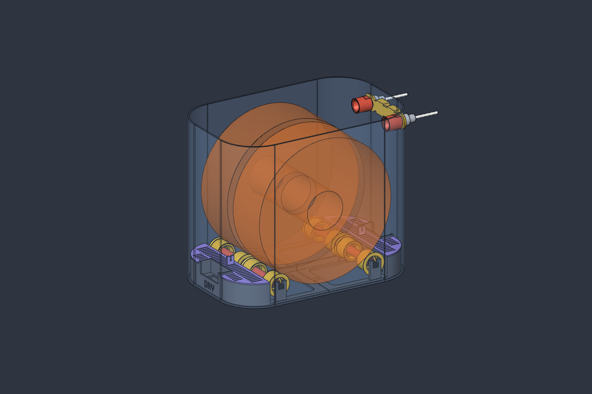
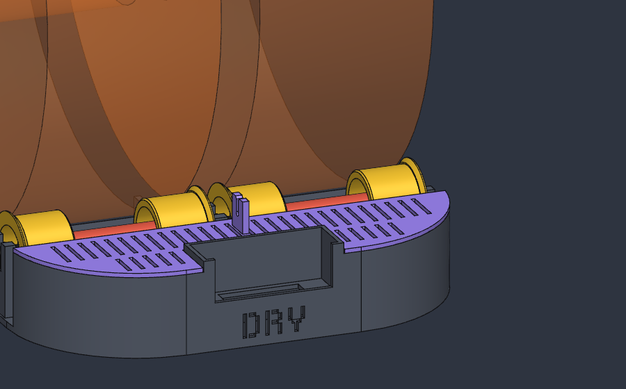
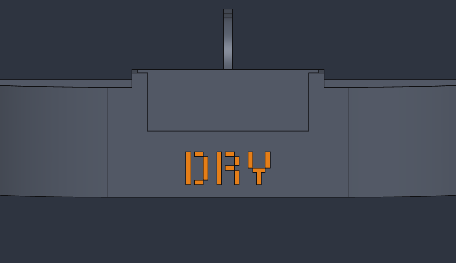
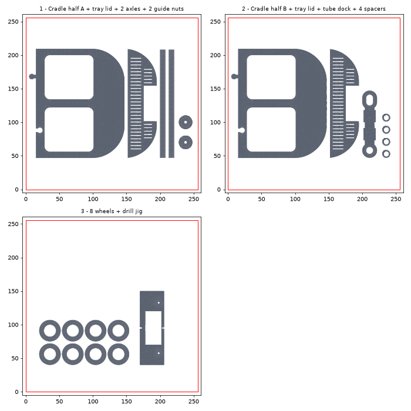
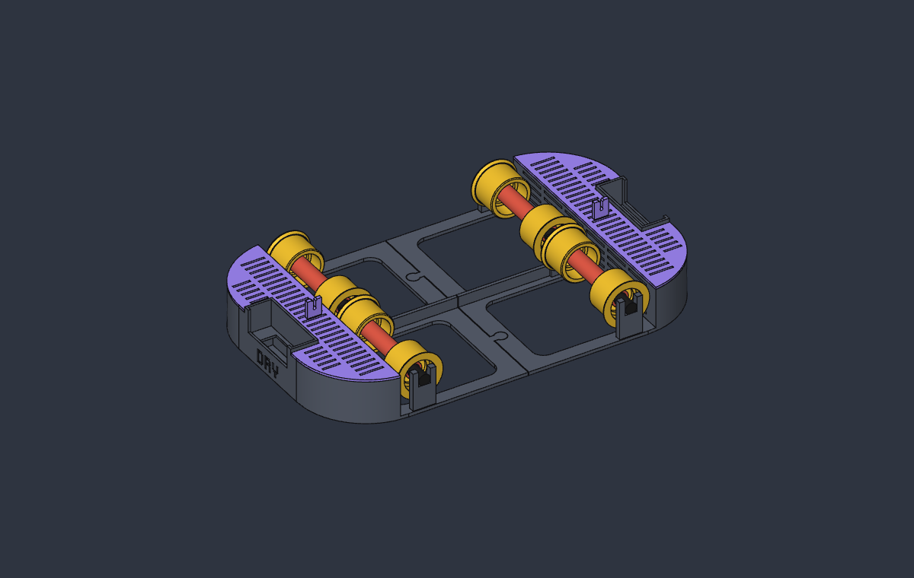

# Dual-Spool Filament Dry Box

**Turn a ₹580 food container into a sealed dry box that holds two 1 kg spools and feeds your printer straight from the box. You only drill two holes.**



[](LICENSE)
[](LICENSE-CODE)


> [!IMPORTANT]
> **This project is 100% AI-generated.** Every 3D model, print file, script, diagram and line of this documentation was created by **Claude** (Anthropic's AI model), working in Claude Code and driving the SolidCraft CAD app. Akshay Prabhu provided the requirements and the feedback. No person drew any of the geometry.
>
> **It has not been printed and assembled yet.** The fits were checked in CAD, including collision checks of the whole assembly, but no one has built it yet. Treat this release as a beta. If you build one, please [report how it went](../../issues/new?template=print_report.md).

---

## Features

- **Two 1 kg spools, side by side.** Each spool rolls on its own 4 bearing wheels, so pulling one spool never turns the other.
- **Spools can't walk off the wheels.** Every wheel has a train-wheel-style lip with a 45° guide cone, which holds the spool flanges on track from both sides. All 8 wheels are the same part, so there's nothing to mix up.

  
- **Desiccant where it does the most good.** Two slotted trays at the ends of the box hold about 170 g of silica gel and face the spools along their whole width. Nothing is packed into the spool hub.
- **Hygrometer built into the cradle.** A pocket holds a mini hygrometer behind the box wall, so you read the humidity through the clear plastic. No hole is needed for it.
- **A "DRY" indicator below the readout.** Stencil letters are cut through the wall in front of a small chamber of colour-changing silica. While the beads are good, **DRY** shows their colour (for example orange); when they change colour (for example green), it's time to dry them. It needs no electronics.

  
- **Print straight from the box.** Push-fit couplers feed PTFE tube to your printer. A funnel inside guides the filament into each coupler, so it never rubs on the drilled hole.
- **Park the tube when you're not printing.** Each feed tube plugs into a second coupler on the outside of the box, so the filament stays sealed end to end.
- **Easy to drill.** A printed drill jig puts both holes in the right place. The bracket that holds the parking couplers has a slotted hole, so it still fits if a hole ends up a few mm off.
- **Light on plastic.** About 220 cm³ of plastic, roughly 200–270 g of PLA depending on your slicer settings. One project file holds every part in its print quantity.
- **No glue and no screws for the printed parts.** The two cradle halves lock together with a moulded puzzle joint, and the axles drop into keyed slots.

## What you need

### Printed parts: one file

**[⬇ Download `DualSpoolDryBox_PRINT_ALL.3mf`](https://github.com/prabhuakshay/dual-spool-dry-box/releases/latest/download/DualSpoolDryBox_PRINT_ALL.3mf)** from the [latest release](../../releases/latest) and open it in Bambu Studio or OrcaSlicer. Every part is already on a plate in the right quantity and orientation, so there's nothing to count or arrange.



| Plate | Contents |
|---|---|
| 1 | Cradle half A · tray lid · 2 axles · 2 guide nuts |
| 2 | Cradle half B · tray lid · tube-dock bridge · 4 axle spacers |
| 3 | 8 wheels (all identical) · drill jig (used once) |

**Suggested settings (PLA or PETG):** 0.2 mm layers (0.28 mm is fine for the cradle halves and lids), 2 walls (3 for the wheels and axles), 10–15 % infill, no supports. **Turn on a brim for the 4 spacers**; they're thin and 57 mm tall. The wheels print with the bearing pocket (and lip) facing up, so they need no supports.

The plates are laid out for a **256 × 256 mm bed** (Bambu A1, P1, X1 and similar). For a smaller bed, use the single-part files in [`src/stl`](src/stl) or [`src/3mf`](src/3mf). The largest part, a cradle half, needs 142 × 163 mm.

### Hardware

| Qty | Item | Notes |
|---|---|---|
| 1 | **Signoraware 9 L Modular Rectangular container** ("740"), 29 × 19 × 24 cm outside | About ₹580. The design is sized for this box; see [Compatibility](#compatibility). |
| 8 | **608ZZ bearing** (8 × 22 × 7 mm) | Standard skateboard bearing |
| 4 | **PC4-M10 push-fit coupler** (4 mm tube, M10 thread), often sold as "PC4-01" | 2 feed couplers, plus 2 to park the tubes. About ₹46 each. |
| 1 | **FY-11 mini digital hygrometer** (LCD, about 48 × 29 × 15 mm) | Measure yours: the pocket is sized for 48.5 × 29 × 15.5 mm |
| ~180 g | **Colour-changing silica gel beads, 2–5 mm** | Must be **2 mm or larger**: every opening in the trays and the DRY window is 1.4 mm or less, so smaller beads could fall out. Colour-changing beads make the DRY indicator work. |
| 2 × length to printer | **PTFE tube, 2 mm ID / 4 mm OD** | |

**Tools:** a drill with a 3.3 mm bit and a step bit (up to 10 mm), a spanner for the coupler hex, and a deburring knife.

## Quick start

1. **Print** the 3 plates of [`DualSpoolDryBox_PRINT_ALL.3mf`](https://github.com/prabhuakshay/dual-spool-dry-box/releases/latest/download/DualSpoolDryBox_PRINT_ALL.3mf).
2. **Press a bearing** into each wheel. Then **thread the wheels and spacers onto the axles** (the lip of every wheel faces outward, toward its tower), and drop them into the cradle.
3. **Snap the two cradle halves together** with their puzzle joint.
4. **Drill two 10 mm holes** in one end of the box, using the drill jig.
5. **Fit the couplers:** tube-dock bridge on the outside, guide nuts on the inside.
6. **Fill the trays** with silica gel, put the lids on, and drop the hygrometer into its pocket.
7. **Lower the cradle into the box, load the spools,** and feed the filament through the couplers.

**Full step-by-step guide with pictures: [docs/ASSEMBLY.md](docs/ASSEMBLY.md)**



## Compatibility

| | Works with |
|---|---|
| **Spools** | 1 kg spools up to **206 mm in diameter** and **50–67 mm wide** (measured across the outside of the flanges), plastic or cardboard. 2 kg spools don't fit. |
| **Box** | Signoraware 9 L Modular Rectangular. For another box, edit the box dimensions in the CAD file; see [docs/CUSTOMIZE.md](docs/CUSTOMIZE.md). |
| **Filament** | Anything that runs through a 4 mm PTFE tube (1.75 mm filament) |

### Common 1 kg spools

| Brand | Spool size (diameter × width) | Fits? |
|---|---|---|
| Numakers | 200 × 59 mm (their size chart) | ✅ |
| SUNLU | ≈203 × 64 mm (listed as 8.00" × 2.50") | ✅ |
| Elegoo (cardboard) | ≈200 mm; sold as Bambu AMS-compatible, so ≤ 67 mm wide | ✅ expected |
| Bambu Lab | ≈200 mm; ≤ 67 mm wide (AMS limit) | ✅ expected |
| AlmightyFila, eSun, Polymaker, Overture and others | Most 1 kg spools are 197–205 × 55–70 mm | ✅ if within the limits above |

Spool sizes aren't standardised, and brands change their spools, so **measure yours**: the outside diameter, and the width across the outside of the two flanges.
Spools narrower than 50 mm (some 500 g or 750 g spools) won't stay on the wheels. Spools wider than 67 mm, which are rare now that Bambu's AMS caps width at 67 mm, won't fit between the lips.

## Using it

- **Printing:** the filament runs from the spool, through the funnel and coupler, and along the PTFE tube to your printer.
- **When you're done:** unload the filament at the printer and pull the tube off the printer. **Plug that loose end into the parking coupler** next to the feed coupler. Both ends of the tube are now sealed.
- **Swapping spools:** clip the loose end into the notch on top of a tray lid's pull tab so it can't unwind.
- **When DRY (or the beads) change colour:** take the tray lids off and pour the beads out. To empty the DRY chamber, lift out the hygrometer and tip the cradle half so the beads run out of the shelf hole. Dry the beads in an oven following the bead maker's instructions. **Don't put the printed parts in the oven.**

## Customise it

The full parametric model is [`src/cad/DualSpoolDryBox.sc`](src/cad/DualSpoolDryBox.sc), made in the SolidCraft parametric CAD app. Box size, spool size, bearing fit, hygrometer size, coupler thread and hole fits are all named parameters. Change one and every part updates. A [STEP export](src/cad/DualSpoolDryBox_parts.step) is included for other CAD tools.
See **[docs/CUSTOMIZE.md](docs/CUSTOMIZE.md)**.

## Repository layout

```
(Releases)                      ← DualSpoolDryBox_PRINT_ALL.3mf: every part, 3 plates; print this
docs/                           assembly guide, customisation guide, images
src/
  stl/  3mf/                    single parts in print orientation (file name = quantity, e.g. _x4)
  cad/                          parametric SolidCraft model + STEP export
dev/                            for maintainers: fit-test coupons and build scripts
```

## Contributing

Print reports are the most useful thing right now, since the design hasn't been built yet. Photos, what fitted, and what didn't all help.
See [CONTRIBUTING.md](CONTRIBUTING.md), or [open an issue](../../issues/new/choose).

## Credits

- **Design, CAD, files and docs:** Claude (Anthropic) in Claude Code, using SolidCraft.
- **Project owner, requirements and review:** Akshay Prabhu.
- **Inspiration:** [Dual-Spool DryBox v2](https://makerworld.com/en/models/876069) by *Psyclist* on MakerWorld, which uses the same container. Its sizes (container floor, coupler spacing) were used as a reference. No geometry from that model is included here.

## License

- **Design files** (models, print files, images, docs): [CC BY-SA 4.0](LICENSE), © 2026 Akshay Prabhu.
  You may share, remix and sell. Credit the project and share remixes under the same license.
- **Scripts** in `dev/tools/`: [MIT](LICENSE-CODE).
