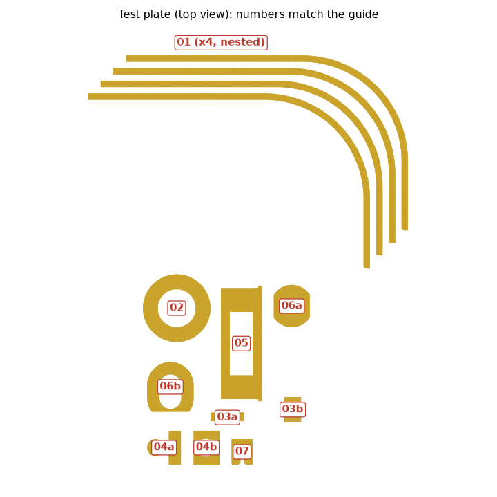
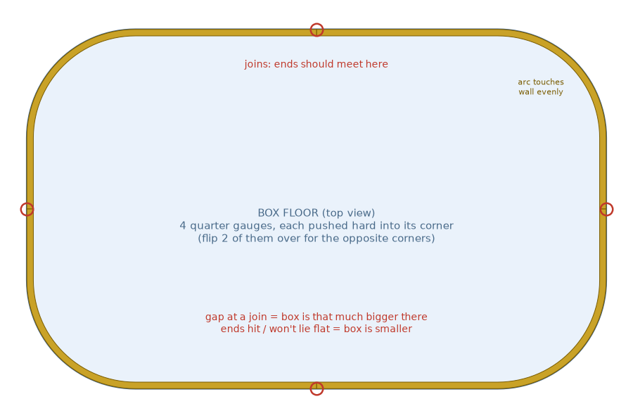
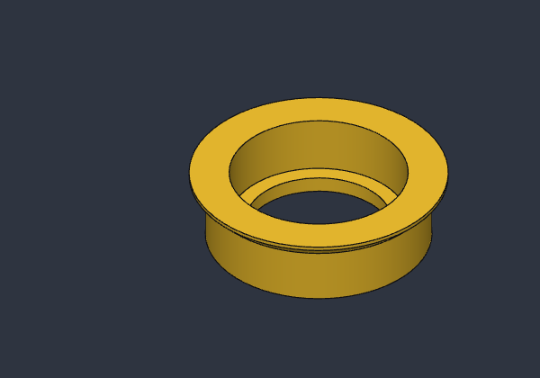
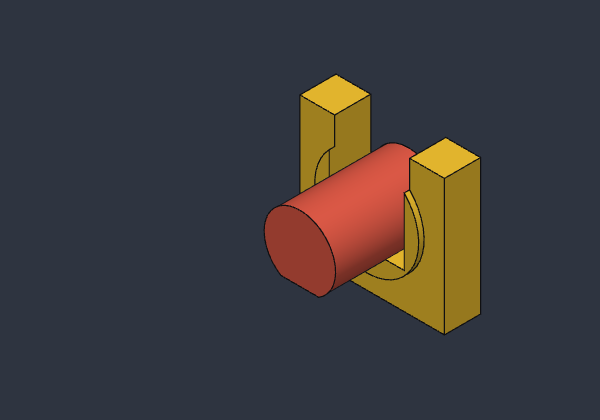
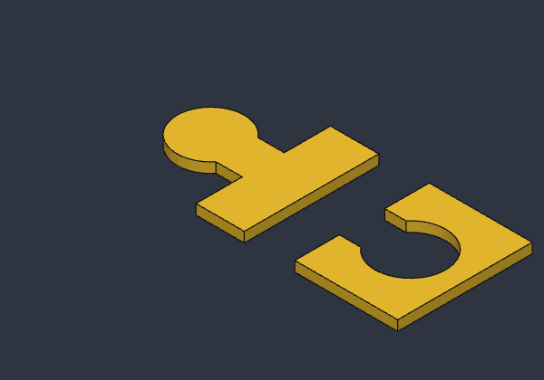
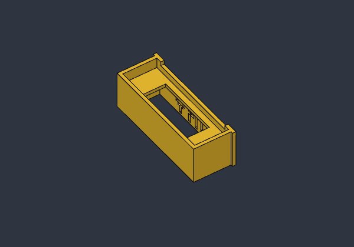
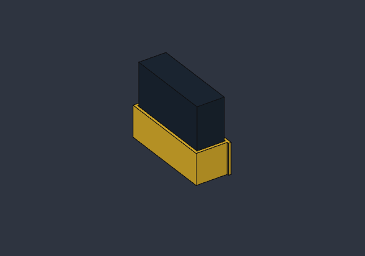
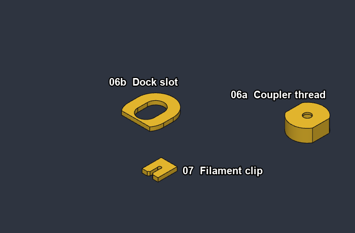

# How to use the fit tests

Maintainer tool: these coupons check that the design files fit the real hardware. Print `3mf/00_ALL_TESTS_PLATE.3mf`.
It's about 14 g. Use the **same slicer profile you'll use for the real parts**, because fits depend on how your printer prints.

Work through the sections below. If a test fails, tell me the test number and what happened (or the number you measured). I'll change the matching setting, the real parts and the tests both update, and I'll re-export them.

You need: the box, one 608 bearing, one PC4-M10 coupler, a spanner, a scrap of 1.75 mm filament, a ruler or calipers, and the hygrometer.

## Which piece is which

| Label | Piece | Tier |
|---|---|---|
| 01 | Floor quarter gauge ×4 (the long nested L-shaped strips at the top) | 1, always |
| 02 | Bearing ring | 1, always |
| 03a / 03b | Axle slot / axle stub | 2 |
| 04a / 04b | Joint tab / joint socket | 2 |
| 05 | Hygrometer pocket | 1, always |
| 06a | Coupler thread | 1, always |
| 06b | Dock slot | 2 |
| 07 | Filament clip | 2 |

**Tier 1** checks your box and hardware against my assumed sizes, so always run it.
**Tier 2** checks your printer's clearances. If this printer already makes good press fits and snap parts, you can skip tier 2.

---

## 01 · Floor quarter gauges: the whole box floor (length, width, corners)

These are 4 identical L-shaped strips. Each is exactly one quarter of the box's inside floor outline: an R50 corner, a 133.5 mm leg and an 82.75 mm leg.
Together they trace the whole floor. On the plate they're nested inside each other only to save space.

1. Put one quarter in each floor corner and push it hard into the corner. For two of the corners you have to **flip the strip over**; that's expected.
2. Look at each arc. **It should touch the box wall evenly along the curve.**
3. Look at the 4 joins, in the middle of each side (red circles in the picture).

- **Pass:** the ends meet at all 4 joins (a gap of 0–1 mm is fine), every strip lies flat, and the arcs sit evenly.
- **Gap at a join:** the box is that much bigger in that direction. Measure the gap and send it to me ("long side gap X mm, short side gap Y mm").
- **Ends collide, or a strip won't lie flat:** the box is smaller. Measure how much the ends overlap and send me that.
- **Arc touches only in its middle:** the box corner is tighter than R50. **Touches only at its ends:** the corner is wider. Tell me which.
- The cradle is 1.5 mm smaller than these gauges all round, so a pass here means the cradle drops in with clearance.
- If the box has a rounded edge where the floor meets the walls, the strips may ride up on it. Press them flat while you check.

## 02 · Bearing ring: 608 press fit

A 9 mm slice of the wheel, including its Ø32 guide lip. The end with the lip is the bearing pocket; the narrow ledge inside is the stop.

1. Press a 608 bearing into the wide end with your thumb, or squeeze it in gently with a vice.

- **Pass:** it goes in and seats against the ledge, doesn't fall out when you shake it, and the bearing still spins freely. The outer lip and its 45° cone printed cleanly, with no drooping underside.
- **Too loose** (falls out) or **too tight** (cracks the ring, or the bearing binds): tell me which. The setting is `brgD`, now 22.1 mm.

## 03 · Axle slot + axle stub: axle seating and anti-rotation (tier 2)

**03a** is the tower top with the axle slot. **03b** is a short piece of axle with a flat on one side.

1. Lay the stub into the slot, flat side down.
2. Try to turn it.
3. Slide a 608 bearing onto the stub.

- **Pass:** it drops in without forcing, sits level, can't be turned by hand, and the bearing slides on easily.
- **Fail:** tell me which of these happened: too tight in the slot, rotates, or the bearing won't go on. The settings are `slotW` and `axD`.

## 04 · Joint tab + socket: puzzle joint between the two cradle halves (tier 2)

1. Turn the socket piece (**04b**) over, or rotate it 180°, so it faces the tab.
2. Press the tab (**04a**) down into the socket.

- **Pass:** it presses in by hand, stays together when you lift it by one piece, and has little side-to-side play.
- **Fail:** tell me "joint too tight" or "joint too loose". The clearance is 0.2 mm per side.

## 05 · Hygrometer pocket: FY-11 fit (tier 1)

The pocket from the floor up to just above the window: the shelf with its fill hole, the DRY bead chamber below it, and the DRY letters in the outer wall.
The coupon has no floor, so beads poured in fall through. Use it for fit checks only.

1. Drop the hygrometer in, screen facing the wall side that has the window cut.

- **Pass:** it slides in without forcing, rests on the shelf, doesn't rattle much, and the bottom edge of the LCD lines up with the bottom of the window.
- **Also check the DRY letters:** the strokes are clean through, with no sag. Hold a 2 mm bead against a letter: it must not pass through.
- **Fail:** measure your hygrometer's width × height × depth and send them to me. The pocket assumes 48.5 × 29 × 15.5 mm.

## 06a · Coupler thread: self-tapping into printed plastic (tier 1)

The block on the right is a slice of the guide nut, with the same 9.2 mm bore as the tube-dock parking hole.

1. Screw the PC4-M10 coupler's metal thread into the hole with a spanner, slowly and straight.

- **Pass:** it cuts its own thread, ends up firm, and doesn't crack the plastic or spin freely.
- **Cracks** means the hole is too small: I'll go to 9.4 mm. **Spins or strips** means it's too big: I'll go to 9.0 mm.

## 06b · Dock slot: coupler clearance (tier 2)

The plate on the left of the same picture is the slotted end of the tube-dock bridge. Its width is the same as the bridge's round hole.

1. Push the coupler's thread through the slot and slide it from one end to the other.

- **Pass:** it goes through, slides the full ±3 mm, and has little play.
- **Fail:** tell me tight or loose. The setting is `cp_clear`.

## 07 · Filament clip: snap-in holder (tier 2)

The small notched plate in the middle of the same picture: a copy of the tray lid's pull tab.

1. Press a piece of 1.75 mm filament down into the notch until it clicks into the round seat.
2. Shake it.
3. Pull it out by hand.

- **Pass:** it clicks in, stays put when shaken, and pulls out by hand.
- **Fail:** tell me "clip too hard" or "clip too loose". The neck is 1.6 mm (1.5 = grips harder, 1.7 = looser).

---

## Measure these instead of printing

| Check | How | Must be |
|---|---|---|
| Box inside height | Ruler from the floor to the underside of the lid | **≥ 215 mm** (spool top sits at about 210 mm) |
| Coupler thread length | From the hex face to the tip of the thread | **≥ 8 mm**. It has to pass through the 2.4 mm bridge tab and the box wall (about 2 mm), with at least 3.5 mm left to grip the guide nut. If it's shorter, tell me and I'll thin the bridge tab. |
| Coupler hex size | Across the flats | ≤ 15 mm, to fit the dock block |
| Hygrometer height | — | About 29 mm, so it sticks up about 8 mm above the pocket for pulling out |

## What these tests do NOT cover

- **Tray lid fit** on the desiccant tray: not tested. It's a cheap part (about 8 g), and its clearance follows the same rules as the other fits.
- **Wheel outside diameter and spool clearance:** not a fit, so nothing to test.
- **The 10 mm holes in the box:** use the drill jig (plate 4). Drill 3.3 mm pilots, then open them up with a step bit.
