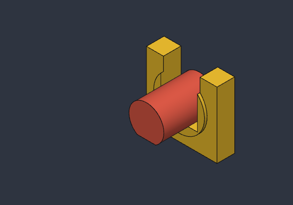
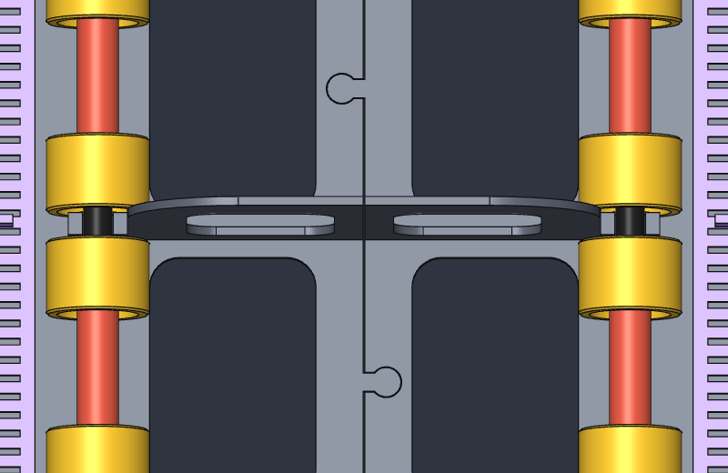
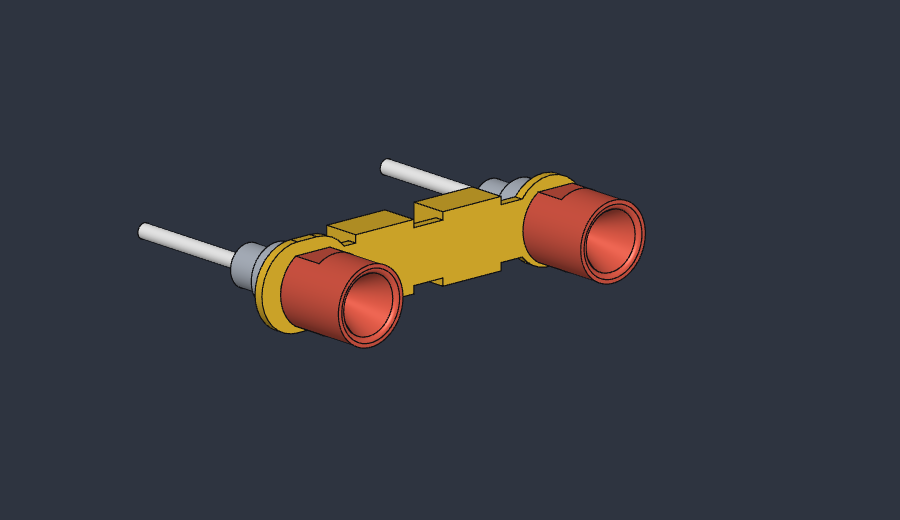
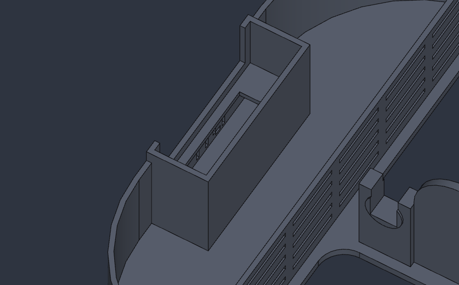
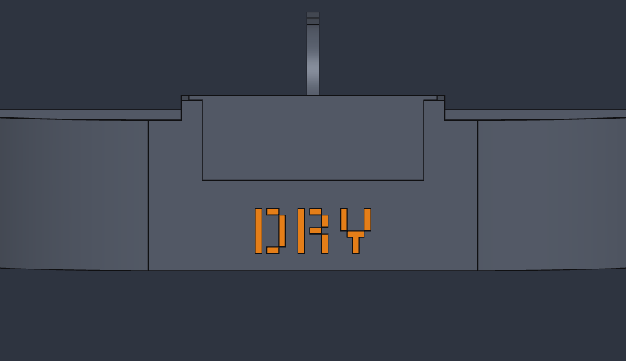
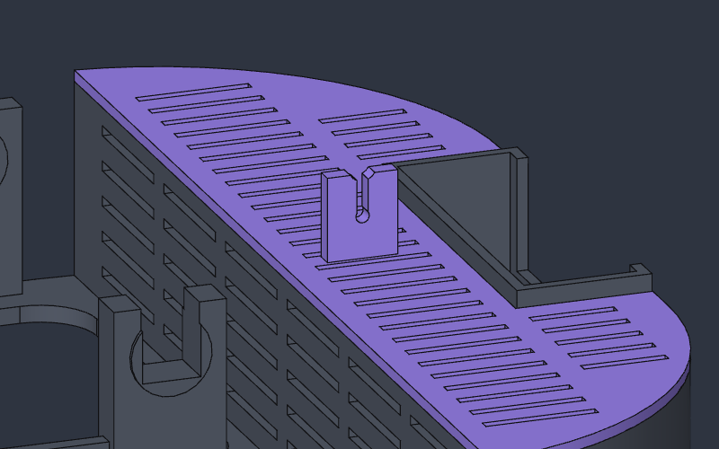

# Assembly guide

[← Back to README](../README.md)

> **100% AI-generated, not yet print-verified.** These steps follow the CAD model. If something doesn't fit as described, please [open a print report](../../../issues/new?template=print_report.md).

**Time:** about 30 minutes, plus printing. **Before you start:** print all 3 plates of [`DualSpoolDryBox_PRINT_ALL.3mf`](https://github.com/prabhuakshay/dual-spool-dry-box/releases/latest/download/DualSpoolDryBox_PRINT_ALL.3mf) (from the latest release), and have the [hardware](../README.md#hardware) ready.

| Part | Qty | Plate |
|---|---|---|
| Cradle half | 2 (identical) | 1, 2 |
| Tray lid | 2 (identical) | 1, 2 |
| Axle | 2 | 1 |
| Guide nut | 2 | 1 |
| Tube-dock bridge | 1 | 2 |
| Axle spacer | 4 | 2 |
| Wheel (all identical, with a lip on the bearing end) | 8 | 3 |
| Drill jig | 1 (used once) | 3 |

---

## 1. Bearings into wheels

Each wheel has one wider end with a ledge inside: that's the bearing pocket.
Press a **608 bearing** into it until it sits on the ledge. A thumb is often enough; for a tight fit, squeeze it in gently with a vice between two flat pieces of wood.
Do this for all **8 wheels**. The bearing goes in the end with the lip.

## 2. Build the two axles

Each axle carries 4 wheels: 2 per spool lane. Each pair is held apart by a spacer.
Slide the parts onto the axle in this order. **The bearing end of every wheel faces outward, toward the tower it will sit next to.**

```
 end ─ ‖[608]Wheel ═ spacer ═ Wheel[608]‖ ─ (gap for the middle tower) ─ ‖[608]Wheel ═ spacer ═ Wheel[608]‖ ─ end
        └────────── lane 1 ──────────┘                                   └────────── lane 2 ──────────┘
            ‖ = lip
```

Every wheel's lip (on its bearing end) faces the tower next to it, so the two lips of each lane hold the spool between them.

The spacer pushes on the bearings' inner rings, so the wheels spin freely while staying in place.



## 3. Drop the axles into the cradle

Each cradle half has 3 small towers with open slots: one at each side and one in the middle.
Lower an axle into a half's slots **with the flat side of the axle facing down**. The flat sits on the flat bottom of each slot, which stops the axle from turning.
Do the same with the second axle in the other half.

## 4. Join the two cradle halves

Both halves are the same part. Turn one round 180° so they face each other.
Lay them flat and **press the tabs down into the sockets**. The puzzle joint stops the halves sliding apart.



## 5. Drill the box

Do this at **one end** of the box. That end becomes the "feed" end.

1. Measure the end wall's width at about 3 cm below the rim band, and mark the centre with a vertical pencil line about 4 cm long.
2. Hold the **drill jig** against the outside of that wall. Push its top edge up under the moulded band below the rim, and slide it sideways until your centre mark sits **exactly between the two arrow tips** in the jig's window. The V-notches on its top and bottom edges show the same centreline.

   
3. Drill the two **3.3 mm pilot holes** through the jig's guide bosses.
4. Remove the jig and open both holes to **10 mm with a step bit**. A step bit doesn't crack the plastic the way a normal 10 mm bit can.
5. Deburr both sides of each hole.

The holes are 75 mm apart and 28 mm below the rim band. The bridge in the next step has a slot at one end, so it still fits if the spacing is a few mm off.

## 6. Couplers, tube dock and guide nuts



1. **Outside the box:** slide the **tube-dock bridge** over the threads of both feed couplers: round hole on one, slot on the other. Push both coupler threads through the box holes.
2. **Inside the box:** screw a **guide nut** onto each coupler thread, funnel facing into the box. Hold the coupler's hex outside with a spanner while you tighten. The guide nut cuts its own thread into the plastic, so go slowly and stop when it's snug. It has flats for a 17 mm spanner.
3. **Parking couplers:** screw the 2 remaining couplers into the two blind holes on the bridge (again self-tapping, so go slowly).


## 7. Desiccant and hygrometer

Use **colour-changing silica beads, 2–5 mm** (not smaller: every opening is 1.4 mm or less).

1. **Fill the DRY chamber first.** At the end where the hygrometer will go, look into the hygrometer pocket: there's a shelf with a rectangular hole. Pour beads through the hole until the chamber under the shelf is full right up to the shelf (about 5 g), and tap the cradle so they settle. The beads now sit right behind the **DRY** letters.
2. Fill both **end trays** with silica gel beads, about 85 g each.
3. Drop a **tray lid** on each tray. The cut-out in the lid fits around the hygrometer pocket.
4. Drop the **hygrometer** into the pocket at that end, screen facing the box wall. It sits on the shelf, covers the fill hole, and sticks out about 10 mm at the top, so you can pull it out.



From outside, **DRY** below the hygrometer shows the colour of the beads behind it:



## 8. Into the box

Lower the whole cradle into the box, with **the hygrometer end against the wall you'll read it through**. The cradle is 1.5 mm smaller than the box floor all round, and the box walls flare out above, so it drops straight in.

## 9. Load the spools

1. Place a spool in each lane so it rests on its **4 wheels**, with each flange on a wheel pair, between the lips.
2. Push the filament end through the **guide nut funnel** and the **coupler**, then into your PTFE tube.
3. Close the lid.

Not printing? Plug the free end of the tube into the **parking coupler**. To keep a loose filament end from unwinding, clip it into the notch on top of a tray lid's pull tab.



---

## Troubleshooting

| Problem | Fix |
|---|---|
| Bearing falls out of a wheel | Add a drop of glue, or report it so the pocket can be made smaller (`brgD`). |
| Axle turns in its slots | Check the flat side faces down. |
| Spool tilts or a flange drops between the wheels | The spool is narrower than 50 mm, which isn't supported. Measure it across the outside of the flanges. |
| Spool won't sit between the lips | It's wider than 67 mm, which isn't supported. |
| Guide nut is hard to start | Turn it back a quarter turn after every half turn, like tapping a thread. A drop of soap helps. |
| Hygrometer is loose or tight in its pocket | Measure it and adjust `hy_w`, `hy_h` and `hy_d` (see [CUSTOMIZE.md](CUSTOMIZE.md)). |
